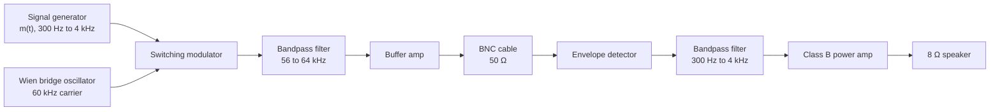

# AM Radio

Single-tone AM transmitter and receiver built from discrete analog blocks. The transmitter generates a 60 kHz carrier with a Wien bridge oscillator, modulates it with a diode switching modulator, cleans it up with an active bandpass filter, and drives a 50 Ω line through a push-pull buffer. The receiver recovers the 300 Hz to 4 kHz audio and plays it on an 8 Ω speaker. All schematics are in LTspice.

## Signal chain



## Design requirements

| Parameter | Requirement |
|---|---|
| Carrier frequency | 40 to 90 kHz (using 60 kHz) |
| Message | Single tone, 300 Hz to 4 kHz |
| Supply | ±12 V |
| Transmit filter, low stopband | ≤ -20 dB from 0 to 4 kHz |
| Transmit filter, passband | Within ±1 dB from fc - 4 kHz to fc + 4 kHz |
| Transmit filter, high stopband | ≤ -10 dB for f ≥ 2fc |
| Line | 50 Ω BNC |
| Output | 8 Ω speaker |

## Transmitter

### Oscillator

Wien bridge oscillator on an OP27.

- R = 2.65 kΩ, C = 1 nF, so f0 = 1/(2πRC) ≈ 60.06 kHz. Simulation lands at 60.28 kHz.
- Gain = 1 + Rf/Rg = 1 + 103k/50k ≈ 3.06, just over the 3 needed for oscillation to build.
- Two diodes with 20 kΩ / 4.7 kΩ dividers to the rails reduce the gain at the peaks and set the amplitude.
- A small pulse on the Jump_Start input kicks it at t = 0 so the simulation doesn't sit at 0 V.

### Switching modulator

An OP27 inverting summer (all resistors 10 kΩ) adds the carrier and the message. The sum drives a diode into a 10 kΩ load. Because the carrier is much bigger than the message, the carrier alone decides when the diode conducts, so the diode acts as a switch at fc.

The output is the input times a 0/1 square wave at fc. Keeping the fc term gives

v(t) ≈ (Ac/2)·[1 + (4/(πAc))·m(t)]·cos(2πfc·t)

plus a baseband copy of m(t) and harmonics at 2fc, 3fc and up, which the bandpass filter removes.

### Bandpass filter

Second order multiple feedback bandpass, centered on the carrier.

| Part | Value |
|---|---|
| R1 (input) | 7.5 kΩ |
| R2 (feedback) | 15 kΩ |
| R3 (to ground) | 510 Ω |
| C1, C2 | 1 nF |

H(s) = -(s/(R1·C)) / (s² + (2/(R2·C))·s + (R1 + R3)/(R1·R2·R3·C²))

- f0 ≈ 59.5 kHz, Q ≈ 2.8, gain at f0 = R2/(2·R1) = 1 (0 dB)
- 4 kHz: -32.4 dB
- 56 to 64 kHz: -0.68 to 0 dB
- 120 kHz (2fc): -12.8 dB

Q has to be above about 2 to get 10 dB down at 2fc, and low enough to keep the ±4 kHz sidebands within 1 dB. R3 tunes f0 without changing the gain.

### Buffer amp

OP27 voltage follower with an NPN/PNP pair of emitter followers inside the feedback loop. The transistors supply the current for the 50 Ω line and the op-amp corrects for their 0.7 V drops. A 1 kΩ resistor from the op-amp output to the emitters carries the load through the crossover region, which keeps the loop from opening up and ringing near 0 V.

## Receiver

In progress. Envelope detector, 300 Hz to 4 kHz bandpass filter, and a class B power amp into the speaker.

## Status

- [x] Oscillator
- [x] Switching modulator
- [x] Transmit bandpass filter
- [x] Buffer amp
- [ ] Full transmitter simulation
- [ ] Receiver
- [ ] Hardware build and testing

## Files

```
transmitter/   LTspice schematics and block symbols, Top.asc ties them together
receiver/      receiver schematics (in progress)
```

To run the transmitter, open `transmitter/Top.asc` in LTspice and run it. The block .asc and .asy files need to stay in the same folder as Top.asc.
