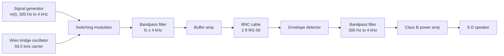
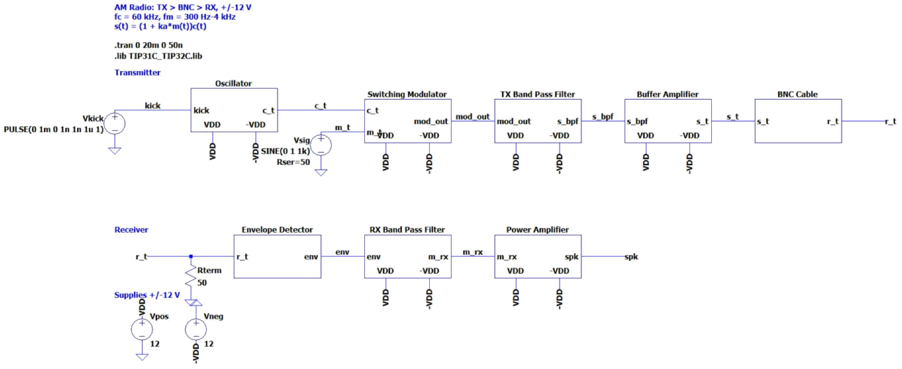
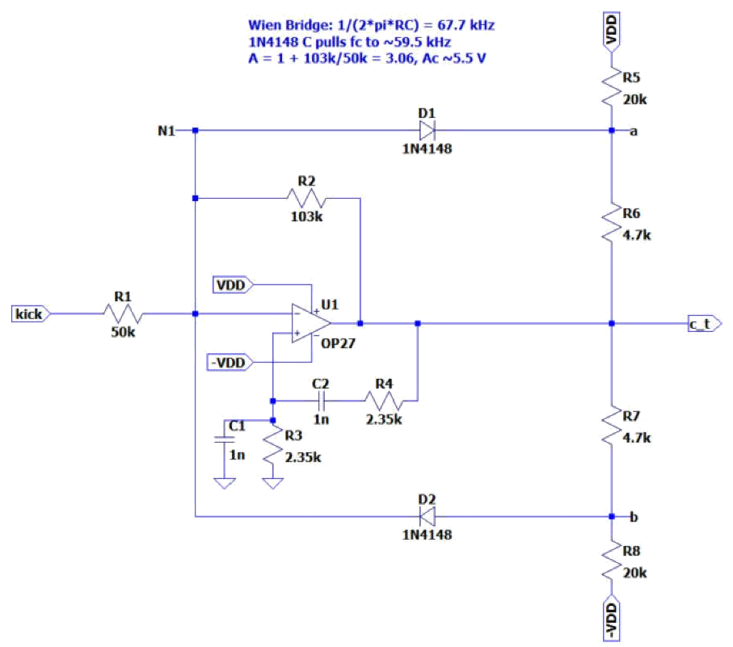
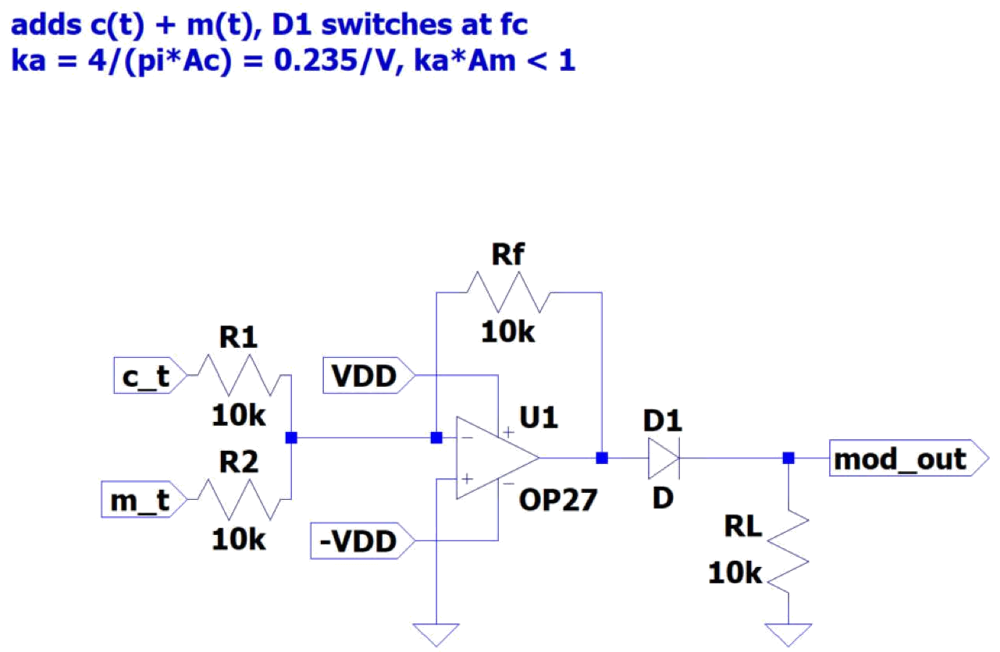
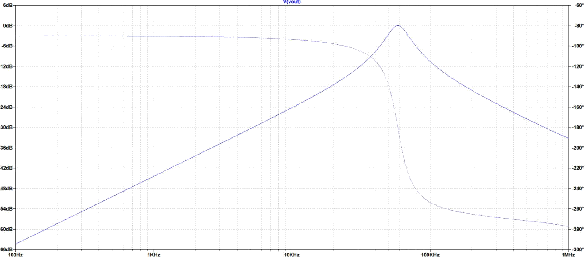
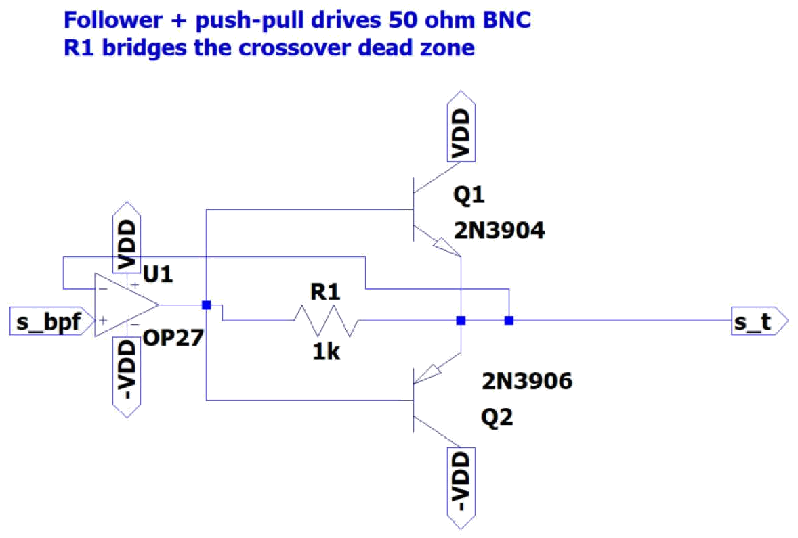
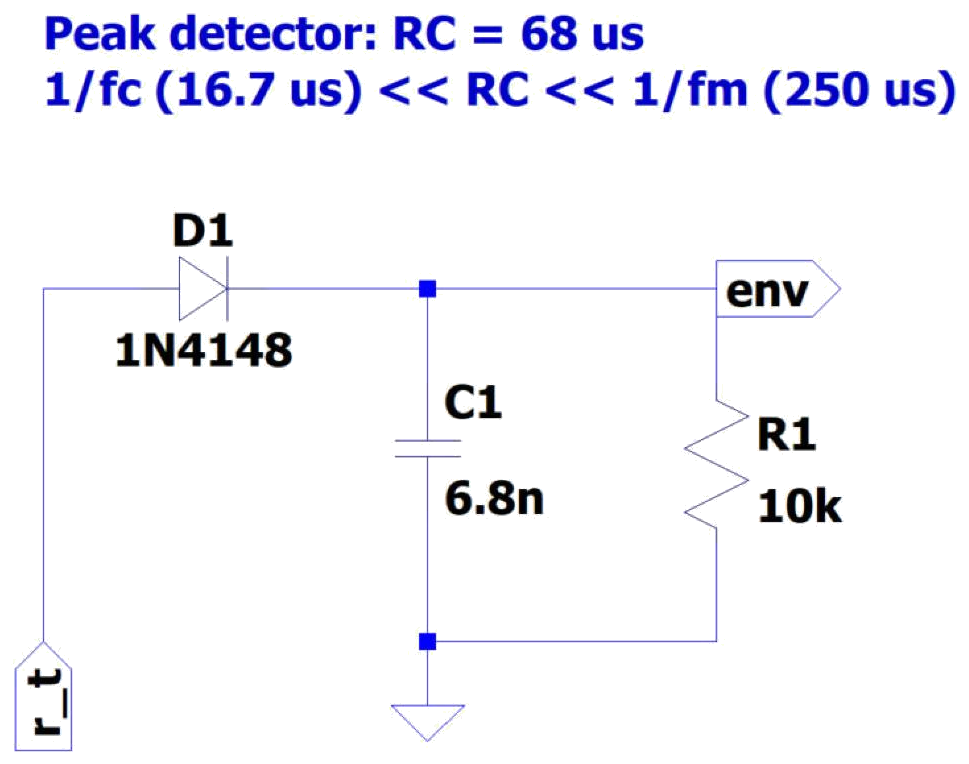

# AM Radio

Single-tone AM transmitter and receiver built from discrete analog blocks. The transmitter generates a 59.5 kHz carrier with a Wien bridge oscillator, modulates it with a diode switching modulator, cleans it up with an active bandpass filter, and drives 2 ft of 50 Ω coax through a push-pull buffer. The receiver pulls the 300 Hz to 4 kHz tone back out with an envelope detector and active filters, then plays it on an 8 Ω speaker through a class B amp. Everything is simulated in LTspice.

## Signal chain





## Results

Full system simulation (`ltspice/Top_sweep.asc`) with a 1 V tone at three frequencies, measured after the receiver filter settles:

| | 300 Hz | 1 kHz | 4 kHz |
|---|---|---|---|
| Speaker amplitude | 1.84 V | 2.02 V | 1.68 V |
| Output / input | 1.85 | 2.03 | 1.68 |
| THD at the speaker | 0.94% | 0.82% | 0.44% |
| Speaker power | 211 mW | 255 mW | 176 mW |

- Carrier: 59.45 kHz, 5.42 V peak. Modulation index 0.27 at 1 V input.
- Carrier ripple at the speaker is 12 mV, under 1% of the tone.
- The 4 kHz tone loses 1.6 dB vs 1 kHz: the transmit filter trims the upper sideband a little and the receiver low-pass takes another 1.3 dB.
- The output is inverted relative to the input because the modulator is an inverting summer. You can't hear it.

## Design requirements

| Parameter | Requirement |
|---|---|
| Carrier frequency | 40 to 90 kHz (using 59.5 kHz) |
| Message | Single tone, 300 Hz to 4 kHz |
| Supply | ±12 V |
| Transmit filter, low stopband | ≤ -20 dB from 0 to 4 kHz |
| Transmit filter, passband | Within ±1 dB from fc - 4 kHz to fc + 4 kHz |
| Transmit filter, high stopband | ≤ -10 dB for f ≥ 2fc |
| Line | 2 ft of 50 Ω BNC |
| Output | 8 Ω speaker |

## Transmitter

### Oscillator

Wien bridge oscillator on an OP27.

- R = 2.35 kΩ, C = 1 nF, so 1/(2πRC) = 67.7 kHz on paper. It actually runs at 59.45 kHz.
- The gap is phase lag. The 1N4148 junction capacitance sits across the 103k feedback resistor and the OP27 has finite bandwidth, which adds about 5° of lag at 60 kHz. The Wien network's phase slope is shallow, so the loop has to drop about 12% in frequency to cancel it.
- I started at R = 2.65 kΩ (60 kHz on paper) and got 53.4 kHz, which put fc - 4 kHz at -3.2 dB on the transmit filter. Lowering R to 2.35 kΩ pulls it back to 59.45 kHz. On the breadboard that's 2.2 kΩ + 150 Ω.
- Gain = 1 + 103k/50k ≈ 3.06, just over the 3 needed for oscillation to build.
- Two diodes with 20 kΩ / 4.7 kΩ dividers to the rails cut the gain at the peaks. Hand calc with a 0.7 V diode drop says 6.2 V peak. Sim gives 5.42 V because the loop gain is only 2% over unity, so the diodes start limiting at a few µA, around 0.33 V.
- A 1 mV step on the kick input starts it at t = 0.



### Switching modulator

An OP27 inverting summer (all resistors 10 kΩ) adds the carrier and the message. The sum drives a diode into a 10 kΩ load. Because the carrier is much bigger than the message, the carrier alone decides when the diode conducts, so the diode acts as a switch at fc.

The output is the input times a 0/1 square wave at fc. Keeping the fc term gives

v(t) ≈ (Ac/2)·[1 + (4/(πAc))·m(t)]·cos(2πfc·t)

plus a baseband copy of m(t) and harmonics at 2fc, 3fc and up, which the bandpass filter removes. With Ac = 5.42 V, ka = 4/(πAc) = 0.235 /V. The sim shows a modulation index of 0.27 at 1 V input, a little higher than 0.235 because the diode drop shrinks the carrier term more than the sidebands.



### Bandpass filter

Second order multiple feedback bandpass, centered on the carrier.

| Part | Value |
|---|---|
| R1 (input) | 7.5 kΩ |
| R2 (feedback) | 15 kΩ |
| R3 (to ground) | 510 Ω |
| C1, C2 | 1 nF |

H(s) = -(s/(R1·C)) / (s² + (2/(R2·C))·s + (R1 + R3)/(R1·R2·R3·C²))

= -1.333e5·s / (s² + 1.333e5·s + 1.396e11)

- f0 = 59.5 kHz, Q = 2.8, gain at f0 = R2/(2·R1) = 1 (0 dB)
- Zero at s = 0, poles at s = -6.67e4 ± j3.68e5 rad/s

LTspice (`ltspice/TX_BPF_AC.asc`) at fc = 59.45 kHz:

| Spec | Requirement | Simulated |
|---|---|---|
| 4 kHz | ≤ -20 dB | -32.4 dB |
| fc - 4 kHz | ±1 dB | -0.32 dB |
| fc + 4 kHz | ±1 dB | -0.89 dB |
| 2fc | ≤ -10 dB | -13.1 dB |

Q has to be above about 2 to get 10 dB down at 2fc, and low enough to keep the ±4 kHz sidebands within 1 dB. R3 tunes f0 without changing the gain. The OP27's finite bandwidth pulls the simulated peak down to 58.2 kHz, which is why the upper edge is the tight one.




### Buffer amp

OP27 voltage follower with an NPN/PNP pair of emitter followers inside the feedback loop. The transistors supply the current for the 50 Ω line and the op-amp corrects for their 0.7 V drops. A 1 kΩ resistor from the op-amp output to the emitters carries the load through the crossover region, which keeps the loop from opening up and ringing near 0 V. Driving a 50 Ω termination it tracks the filter output to within 3 mV at 60 mA peak.



### BNC cable

2 ft of RG-58 modeled as one LC section: 152 nH and 61 pF (250 nH/m and 100 pF/m). Z0 = 50 Ω and the delay is about 3 ns. At 60 kHz the cable has no measurable effect. The 50 Ω termination at the receiver input is there as a worst case load for the buffer.


## Receiver

### Envelope detector

1N4148 into 6.8 nF and 10 kΩ, so RC = 68 µs.

- 1/fc = 16.8 µs ≪ RC ≪ 1/fm = 250 µs, so it holds the peaks without falling behind the tone.
- Diagonal clipping limit at 4 kHz with μ = 0.25 is √(1 - μ²)/(μ·2π·fm) = 154 µs, so there's margin. With 10 kΩ, C can go up to about 15 nF before 4 kHz starts clipping.
- Output is 1.47 V DC plus the tone (0.52 V at 1 kHz) with about 0.1 V of carrier ripple. The next filter removes both.



### Bandpass filter

Two unity-gain Sallen-Key stages. A high-pass (10 nF, 150 kΩ, 106 Hz) blocks the detector's DC, then a low-pass (16 kΩ, 1 nF, 9.95 kHz) removes the carrier ripple. Equal parts give Q = 0.5 per stage.

H(s) = s²/(s + 666.7)² · 3.906e9/(s + 6.25e4)²

| Frequency | Calculated | LTspice |
|---|---|---|
| 300 Hz | -1.03 dB | -1.04 dB |
| 1 kHz | -0.18 dB | -0.19 dB |
| 4 kHz | -1.31 dB | -1.32 dB |
| 59.45 kHz | -31.3 dB | -31.3 dB |

The op-amp symbols are mirrored in the schematic, so VDD lands on the lower supply pin. The high-pass time constant is 1.5 ms, so the output takes about 10 ms to settle after power-up.


### Power amp

OP27 non-inverting stage, gain 1 + 30k/10k = 4, driving a TIP31C/TIP32C push-pull pair. Feedback comes from the speaker node so the op-amp corrects the crossover dead zone, and a 220 Ω resistor carries small signals across it.

- 255 mW into 8 Ω at 1 kHz, 0.25 A peak
- About 0.84 W per transistor (VCC·Ip/π - Ip²·RL/4), under the 2 W free-air rating, so no heatsink
- TIP31C/TIP32C models are the Fairchild ones from the Oregano model library (`ltspice/TIP31C_TIP32C.lib`)


## Status

- [x] Oscillator
- [x] Switching modulator
- [x] Transmit bandpass filter
- [x] Buffer amp
- [x] Full transmitter simulation
- [x] Receiver
- [x] Full system simulation at 300 Hz, 1 kHz and 4 kHz
- [ ] Hardware build and testing
- [ ] Microphone input

## Files

```
ltspice/    schematics, block symbols, test benches, TIP31C/TIP32C models
sim_data/   LTspice results exported as CSV (filter sweeps and waveforms)
images/     schematic and frequency response screenshots
```

Open `ltspice/Top.asc` for the full system with a 1 kHz tone, or `ltspice/Top_sweep.asc` to step through 300 Hz, 1 kHz and 4 kHz. `TX_BPF_AC.asc` and `RX_BPF_AC.asc` sweep each filter on its own. Keep everything in `ltspice/` together, since LTspice looks for the block schematics in the same folder as the top level.
