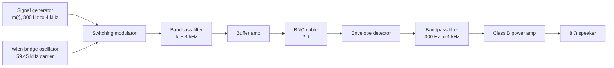
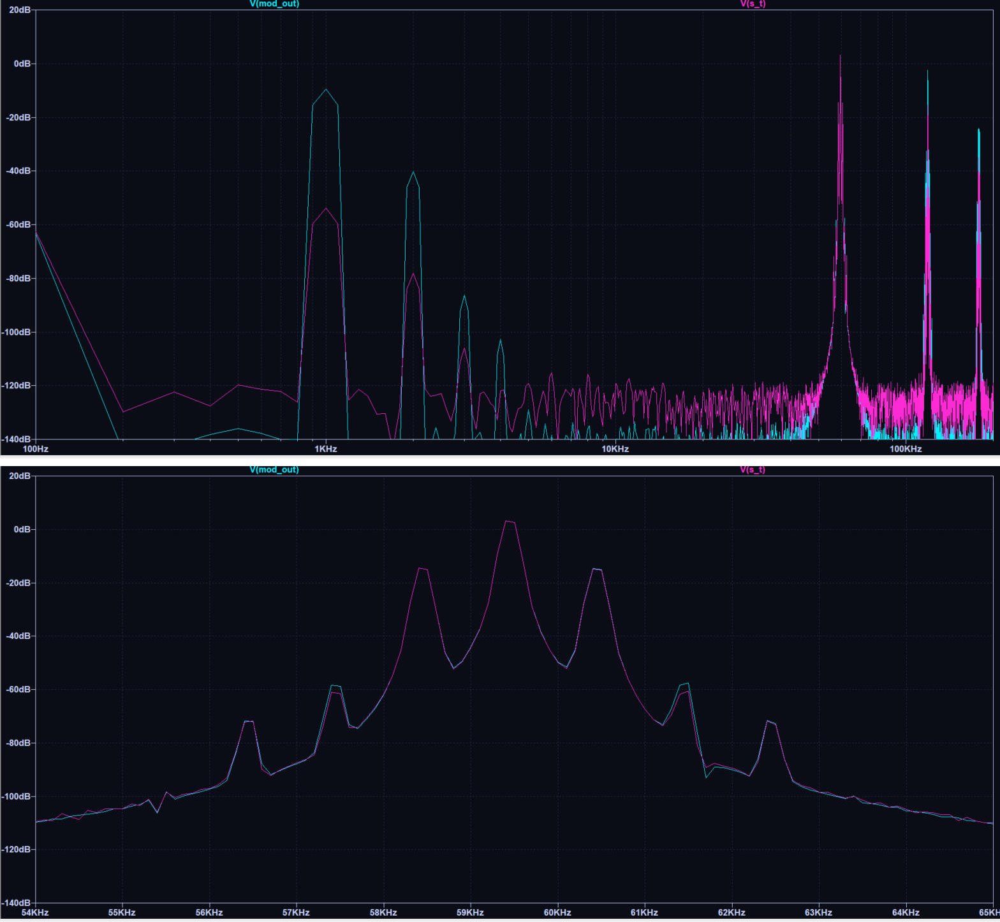
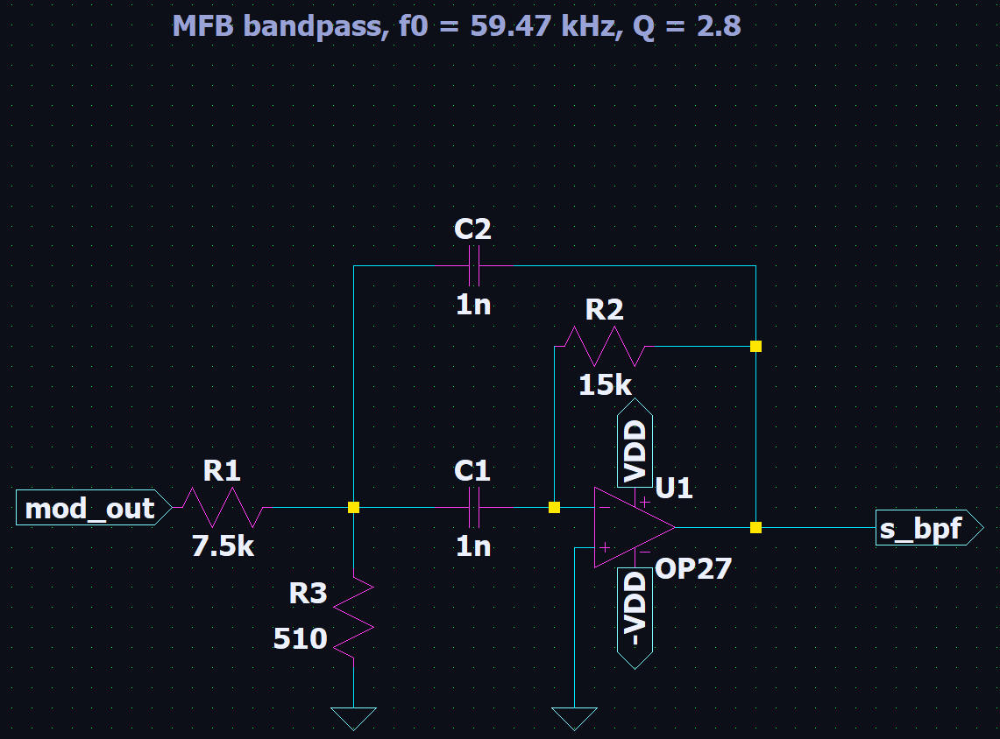
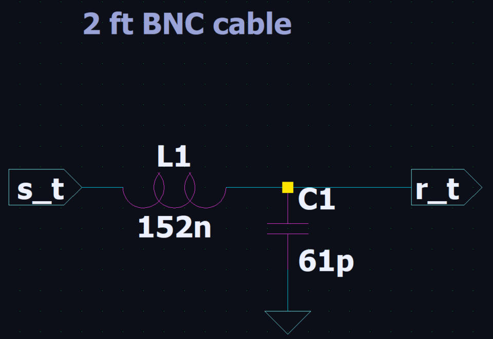
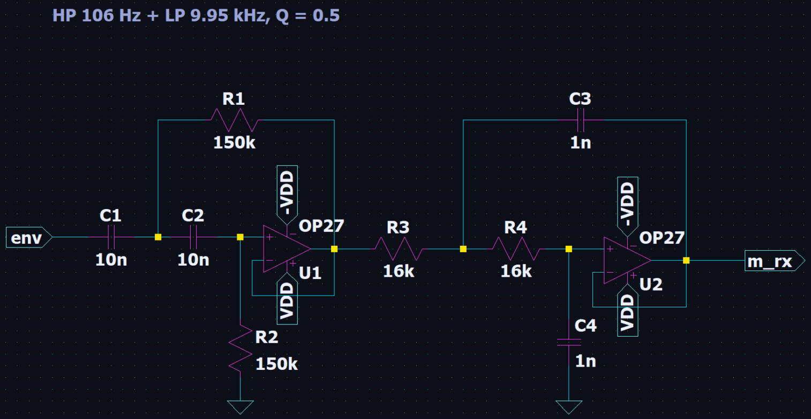
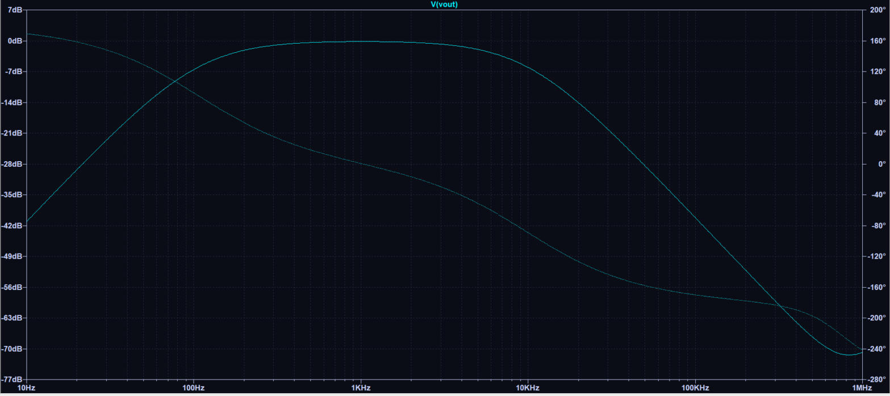
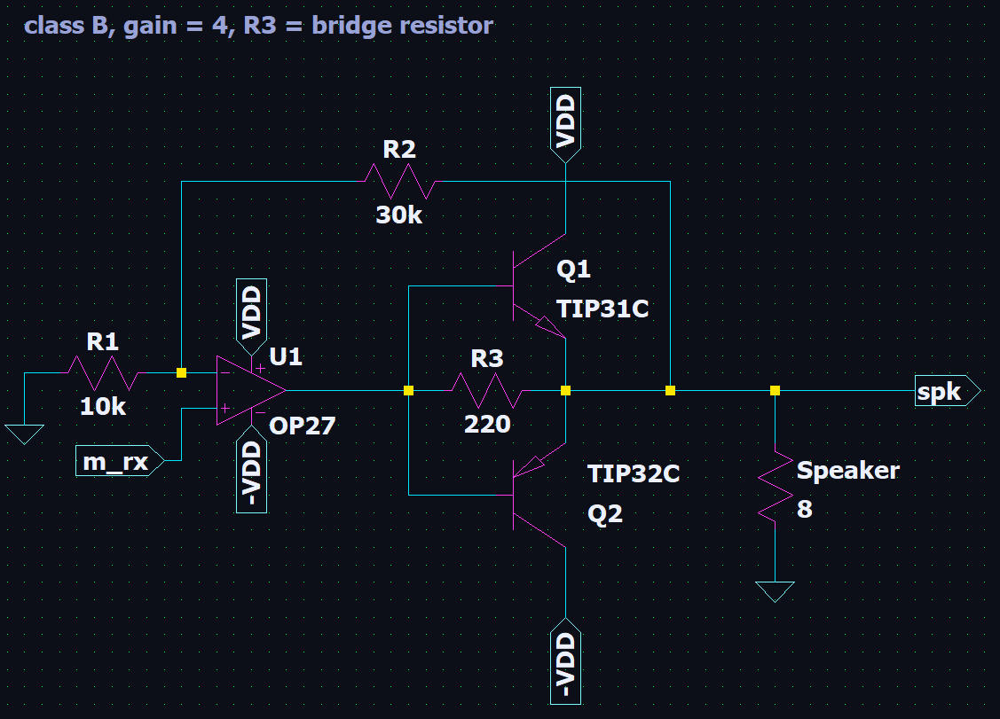
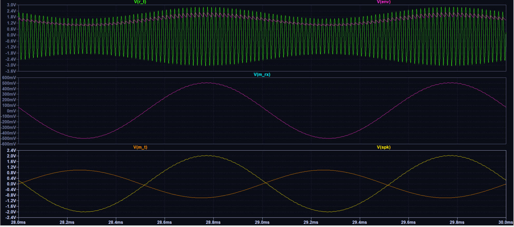
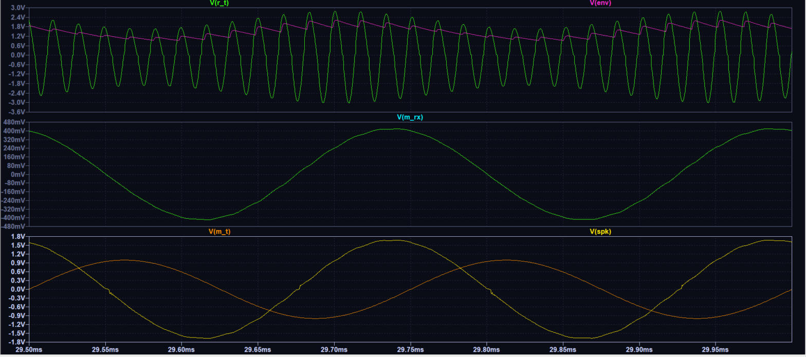

# AM Radio

A single tone AM transmitter and receiver built from analog blocks and simulated in LTspice. A 300 Hz to 4 kHz tone is put on a 59.45 kHz carrier, sent through 2 ft of BNC cable, and played back out of an 8 Ω speaker.

## Signal chain

## Requirements

| Parameter | Requirement |
|---|---|
| Carrier frequency | 40 to 90 kHz (using 59.45 kHz) |
| Message | Single tone, 300 Hz to 4 kHz |
| Supply | ±12 V |
| TX filter, 0 to 4 kHz | ≤ -20 dB |
| TX filter, fc ± 4 kHz | Within ±1 dB |
| TX filter, f ≥ 2fc | ≤ -10 dB |
| Line | 2 ft BNC cable |
| Output | 8 Ω speaker |

## How it works

### Amplitude modulation

The carrier amplitude follows the message. With a single tone the spectrum is the carrier plus one sideband on each side at fc ± fm, so the bandwidth is 2W = 8 kHz for a 4 kHz message.

$$s(t) = A_c\left[1 + k_a m(t)\right]\cos(2\pi f_c t), \qquad \mu = k_a A_m$$

### Oscillator

Wien bridge oscillator on an OP27. It runs at the frequency where the Wien network has zero phase shift, and the op-amp needs a gain of at least 3 to keep it going. Two diodes limit the amplitude so it does not keep growing.

$$f_0 = \frac{1}{2\pi RC}, \qquad A_v = 1 + \frac{R_2}{R_1} = 1 + \frac{103k}{50k} = 3.06$$

With R = 2.35 kΩ and C = 1 nF the simulated carrier is 59.45 kHz with a 5.42 V peak.

### Switching modulator

An inverting summer adds the carrier and the message, then a 1N4148 diode turns on and off at the carrier frequency because the carrier is much bigger than the message. That is the same as multiplying the sum by a square wave, and the part near fc is an AM signal:

$$v(t) \approx \frac{A_c}{2}\left[1 + \frac{4}{\pi A_c}\, m(t)\right]\cos(2\pi f_c t), \qquad k_a = \frac{4}{\pi A_c}$$

The rest of the terms land at DC, fm, and harmonics of fc, so a bandpass filter comes next.

FFT at 1 kHz, modulator output (cyan) and TX filter output (pink):

### TX bandpass filter

Multiple feedback bandpass filter on one OP27, centered on the carrier. R1 = 7.5 kΩ, R2 = 15 kΩ, R3 = 510 Ω, C = 1 nF.

$$H(s) = \frac{-\dfrac{s}{R_1 C}}{s^2 + \dfrac{2}{R_2 C}\,s + \dfrac{R_1 + R_3}{R_1 R_2 R_3 C^2}}$$

$$f_0 = 59.47\ \text{kHz}, \qquad Q = \pi f_0 R_2 C = 2.8, \qquad |H(f_0)| = \frac{R_2}{2R_1} = 1$$

All three filter specs pass in simulation.

### Buffer amp and cable

OP27 follower with a 2N3904/2N3906 push-pull stage to drive the 50 Ω cable. The transistors do not turn on until about 0.7 V, so a 1 kΩ bridge resistor from the op-amp output to the output node carries the signal through that threshold. The 2 ft cable is modeled as a simple LC section.

### Envelope detector

1N4148 into 6.8 nF and 10 kΩ. The capacitor charges up to the peaks and discharges through the resistor, so the RC has to sit between the carrier period and the message period:

$$\frac{1}{f_c} \ll R_L C \ll \frac{1}{W} \quad\Rightarrow\quad 16.8\ \mu s \ll 68\ \mu s \ll 250\ \mu s$$

### RX bandpass filter

Two unity gain Sallen-Key stages. A 106 Hz high pass blocks the DC from the detector and a 9.95 kHz low pass removes the carrier ripple. Equal parts give Q = 0.5, so each stage has a double pole at 1/RC:

$$H(s) = \frac{s^2}{(s + \omega_1)^2}\cdot\frac{\omega_2^2}{(s + \omega_2)^2} = \frac{s^2}{(s + 666.7)^2}\cdot\frac{3.906\times 10^9}{(s + 6.25\times 10^4)^2}$$

### Power amp

OP27 with a gain of 4 driving a TIP31C/TIP32C class B pair into the 8 Ω speaker. Feedback is taken from the speaker node, and a 220 Ω bridge resistor gets the signal through the transistor threshold the same way as in the buffer.

$$A_v = 1 + \frac{R_2}{R_1} = 4, \qquad P_L = \frac{V_p^2}{2R_L}, \qquad P_Q = \frac{V_{CC} I_p}{\pi} - \frac{I_p^2 R_L}{4}$$

At 1 kHz that is about 253 mW into the speaker and 0.83 W per transistor.

### Full system

`ltspice/Top_sweep.asc` runs the whole chain at 300 Hz, 1 kHz and 4 kHz. In each plot the top pane is the received signal and the detector output, the middle pane is the RX filter output, and the bottom pane is the input tone (orange) and the speaker (yellow). The speaker output is inverted because the modulator uses an inverting summer.

1 kHz:

4 kHz:

